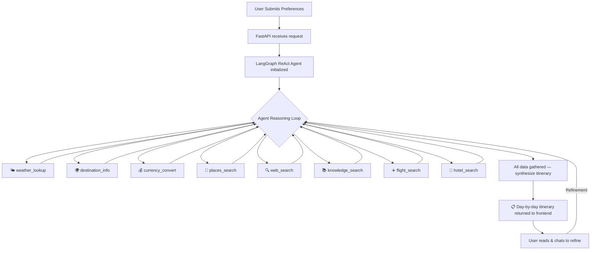

<p align="center">
  
</p>

<h1 align="center">✈️ TriPi — Agentic AI Travel Planner</h1>

<p align="center">
  <strong>An autonomous, tool-calling AI agent that plans hyper-personalized travel itineraries using live data.</strong><br/>
  Built with <b>LangGraph</b> · <b>Google Gemini</b> · <b>FastAPI</b> · <b>Next.js</b>
</p>

<p align="center">
  
  
  
  
  
  
</p>

---

## 🧠 What Is TriPi?

TriPi is not a simple chatbot — it's a **fully autonomous agentic AI system** that acts as your personal travel concierge. Given a destination, dates, budget, and personal preferences, the agent:

1. **Autonomously decides** which real-time tools to call (weather, flights, attractions, currency, web search, knowledge base)
2. **Gathers live data** from 8+ external APIs and a built-in RAG knowledge base
3. **Synthesizes everything** into a rich, day-by-day itinerary with timings, costs, restaurant picks, and indoor backup plans
4. **Refines on demand** — chat with the agent to swap activities, adjust budget, or ask follow-up questions using full conversational memory

> **In short:** You describe your dream trip → TriPi does everything a human travel agent would — automatically.

---

## ✨ Key Features

| Feature | Description |
|---|---|
| 🤖 **Autonomous Agent** | LangGraph ReAct agent that dynamically selects and chains tools based on your preferences — no hardcoded flows |
| 🌤️ **Live Weather** | Real-time forecasts via Open-Meteo for your exact travel dates |
| ✈️ **Flight Search** | Live flight schedules, airlines & pricing via SerpApi / Google Flights |
| 🏨 **Hotel Search** | Accommodation options via Amadeus API with filtering by amenities & budget |
| 💰 **Currency Conversion** | Auto-converts your budget to local currency via ExchangeRate-API |
| 📍 **Smart Places Discovery** | Top attractions, restaurants & hidden gems via Overpass / OpenStreetMap |
| 🌍 **Destination Intelligence** | Country facts, visa requirements, language, timezone via REST Countries |
| 🔍 **Web Search Fallback** | Current events, festivals & travel advisories via DuckDuckGo |
| 📚 **RAG Knowledge Base** | Curated travel guides (safety tips, packing lists, budget hacks) stored in ChromaDB |
| 💬 **Conversational Refinement** | Chat with the agent to tweak your itinerary — powered by LangGraph memory |
| 🗺️ **Interactive Map** | Leaflet.js map with color-coded day markers, route polylines, and custom popups |
| 💸 **Budget Tracker** | SVG donut chart, progress bar, and per-category spending breakdown |
| 📸 **Photo Previews** | Unsplash-powered destination photo gallery with lightbox viewer |
| 📄 **PDF Export** | Download a beautifully formatted A4 itinerary with branded cover page |
| 🎨 **Premium UI** | Glassmorphism design system with dark/light themes, Framer Motion animations, and responsive layout |

---

## 🏗️ Architecture

```
┌─────────────────────────────────────────────────────────────────────┐
│                         FRONTEND (Next.js)                         │
│  Landing Page ─── Preference Form ─── Itinerary View ─── Chat UI  │
│         Framer Motion  ·  Glassmorphism  ·  React Markdown         │
└──────────────────────────────┬──────────────────────────────────────┘
                               │  REST API (JSON)
                               ▼
┌─────────────────────────────────────────────────────────────────────┐
│                        BACKEND (FastAPI)                           │
│                                                                     │
│  POST /api/generate   ─── Create new itinerary from preferences     │
│  POST /api/refine     ─── Refine existing itinerary with feedback   │
│  POST /api/chat       ─── Free-form conversation with agent         │
│  GET  /health         ─── Health check                              │
│                                                                     │
│  Session Manager (in-memory) ──► maps session_id → thread_id        │
└──────────────────────────────┬──────────────────────────────────────┘
                               │
                               ▼
┌─────────────────────────────────────────────────────────────────────┐
│                  LANGGRAPH ReAct AGENT (Gemini 3.5 Flash)          │
│                                                                     │
│   System Prompt ──► Tool Selection Loop ──► Synthesize Itinerary   │
│                                                                     │
│   ┌──────────┐ ┌──────────┐ ┌──────────┐ ┌──────────┐             │
│   │ Weather  │ │ Flights  │ │  Places  │ │ Currency │             │
│   └──────────┘ └──────────┘ └──────────┘ └──────────┘             │
│   ┌──────────┐ ┌──────────┐ ┌──────────┐ ┌──────────┐             │
│   │  Hotels  │ │  Search  │ │  Destn.  │ │   RAG    │             │
│   └──────────┘ └──────────┘ └──────────┘ └──────────┘             │
│                                                                     │
│   MemorySaver (conversation memory across refinements)              │
└─────────────────────────────────────────────────────────────────────┘
                               │
                               ▼
┌─────────────────────────────────────────────────────────────────────┐
│                     KNOWLEDGE LAYER (RAG)                           │
│                                                                     │
│   ChromaDB Vector Store ◄── Markdown Docs (safety, packing, tips)  │
│   LangChain Text Splitters  ·  Google Generative AI Embeddings     │
└─────────────────────────────────────────────────────────────────────┘
```

---

## 🛠️ Technology Stack

### Backend
| Technology | Purpose |
|---|---|
| **Python 3.10+** | Core runtime |
| **FastAPI + Uvicorn** | Async REST API server |
| **LangGraph** | ReAct agent orchestration with built-in tool loop |
| **LangChain** | LLM abstractions, tool definitions, memory management |
| **Google Gemini 3.5 Flash** | Large Language Model powering reasoning & generation |
| **ChromaDB** | Vector database for RAG knowledge retrieval |
| **Pydantic v2** | Request/response validation & agent state schema |

### Frontend
| Technology | Purpose |
|---|---|
| **Next.js 16** | React framework with App Router |
| **TypeScript** | Type-safe frontend code |
| **Framer Motion** | Smooth page transitions & micro-animations |
| **React Markdown** | Renders agent's markdown itineraries |
| **Leaflet.js + React Leaflet** | Interactive maps with custom markers & polylines |
| **html2pdf.js** | Client-side PDF generation |
| **Vanilla CSS** | Custom glassmorphism design system with CSS variables |

### External APIs
| API | Data Provided |
|---|---|
| **Open-Meteo** | Weather forecasts (free, no key required) |
| **ExchangeRate-API** | Real-time currency conversion (free tier) |
| **REST Countries** | Country facts, currencies, languages, timezones |
| **Overpass / OpenStreetMap** | Points of interest, attractions, restaurants |
| **DuckDuckGo Search** | Web search fallback for current events |
| **Unsplash** *(optional)* | Destination photos for visual previews |
| **SerpApi** *(optional)* | Google Flights data — schedules & pricing |
| **Amadeus** *(optional)* | Flight & hotel search with filtering |

---

## 🚀 Getting Started

### Prerequisites

- **Python 3.10+** — [python.org](https://www.python.org/downloads/)
- **Node.js 18+** — [nodejs.org](https://nodejs.org/)
- **Google Gemini API Key** — [aistudio.google.com](https://aistudio.google.com/apikey) (free)

### 1. Clone the Repository

```bash
git clone https://github.com/Shubhammm24/TriPi.git
cd TriPi
```

### 2. Configure Environment Variables

Create a `.env` file in the project root:

```env
# ─── Required ──────────────────────────────────────────
GOOGLE_API_KEY=your_gemini_api_key_here

# ─── Optional (enhance agent capabilities) ────────────
SERPAPI_KEY=              # Google Flights search (free: 100 searches/mo)
AMADEUS_API_KEY=          # Flight & hotel search (free test tier)
AMADEUS_API_SECRET=       # Amadeus authentication secret
UNSPLASH_ACCESS_KEY=      # Destination photos (free: unsplash.com/developers)
```

> **Note:** TriPi works fully with just the `GOOGLE_API_KEY`. The optional keys unlock premium flight and hotel search tools.

### 3. Backend Setup (FastAPI)

```bash
# Create and activate virtual environment
python -m venv venv
venv\Scripts\activate          # Windows
# source venv/bin/activate     # macOS / Linux

# Install Python dependencies
pip install -r requirements.txt

# (Optional) Seed the RAG knowledge base with travel guides
python -m rag.ingest

# Start the backend server
python -m uvicorn main:app --reload --port 8000
```

> 🟢 Backend API running at **http://localhost:8000**
> 📖 Interactive API docs at **http://localhost:8000/docs**

### 4. Frontend Setup (Next.js)

Open a **new terminal**:

```bash
cd frontend

# Install Node dependencies
npm install

# Start the dev server
npm run dev
```

> 🟢 Frontend running at **http://localhost:3000**

### 5. Use the App

1. Open **http://localhost:3000** in your browser
2. Click **"Start Planning"** to access the preference form
3. Fill in your destination, dates, budget, and interests
4. Hit **"Generate Itinerary"** — the agent autonomously gathers data and builds your plan
5. Use the **chat panel** to refine, ask questions, or swap activities

---

## 📁 Project Structure

```
TriPi/
├── agent/                          # LangGraph ReAct agent
│   ├── graph.py                    #   Agent builder — wires LLM + tools + memory
│   ├── prompts.py                  #   System prompt & itinerary generation template
│   ├── state.py                    #   Pydantic state schema (TripRequest, AgentState)
│   └── callbacks.py                #   Streaming tool activity callbacks for UI
│
├── tools/                          # Agent tool definitions (LangChain @tool)
│   ├── weather.py                  #   Open-Meteo weather forecast
│   ├── flights.py                  #   SerpApi / Google Flights search
│   ├── hotels.py                   #   Amadeus hotel search
│   ├── places.py                   #   Overpass POI & attraction search
│   ├── destination.py              #   REST Countries destination facts
│   ├── currency.py                 #   ExchangeRate-API currency conversion
│   ├── web_search.py               #   DuckDuckGo web search fallback
│   └── knowledge.py                #   ChromaDB RAG knowledge retrieval
│
├── rag/                            # Retrieval-Augmented Generation
│   ├── data/                       #   Markdown knowledge docs
│   │   ├── safety_tips.md          #     Travel safety guidelines
│   │   ├── packing_guides.md       #     Packing checklists by trip type
│   │   └── budget_tips.md          #     Budget travel strategies
│   ├── ingest.py                   #   Chunks & embeds docs into ChromaDB
│   └── store.py                    #   ChromaDB retrieval interface
│
├── frontend/                       # Next.js web application
│   └── src/app/
│       ├── page.tsx                #   Landing page with features & hero
│       ├── plan/page.tsx           #   Preference form → itinerary view → chat
│       ├── components/Navbar.tsx   #   Navigation bar (dark/light toggle)
│       ├── globals.css             #   Glassmorphism design system
│       └── layout.tsx              #   Root layout with metadata
│
├── utils/
│   └── travel_agent.py             # Legacy Streamlit agent (v1 reference)
│
├── main.py                         # FastAPI server — /api/generate, /refine, /chat
├── app.py                          # Legacy Streamlit app (v1)
├── test_agent.py                   # Agent integration tests
├── test_api.py                     # API endpoint tests
├── requirements.txt                # Python dependencies
├── .env.example                    # Environment variable template
└── DOCUMENTATION.md                # Detailed prompt & output documentation
```

---

## 🔧 API Reference

### `POST /api/generate`

Generate a new itinerary from travel preferences.

**Request Body:**
```json
{
  "destination": "Tokyo",
  "origin": "New York",
  "duration": 5,
  "start_date": "2026-10-01",
  "end_date": "2026-10-06",
  "budget": "$3000",
  "purpose": "Cultural",
  "interests": ["Food & Dining", "History & Culture"],
  "dietary_preferences": ["Vegetarian"],
  "accommodation_type": "Mid-range",
  "hidden_gems_preference": true
}
```

**Response:**
```json
{
  "session_id": "uuid-string",
  "itinerary": "# Your 5-Day Tokyo Itinerary\n\n## Day 1: Arrival & Asakusa...",
  "tool_calls": ["weather_lookup", "destination_info", "currency_convert", "places_search"]
}
```

### `POST /api/refine`

Refine an existing itinerary using conversational memory.

```json
{
  "session_id": "uuid-from-generate",
  "feedback": "Replace day 3 with a food tour and add more ramen spots"
}
```

### `POST /api/chat`

Free-form conversation with the travel agent.

```json
{
  "session_id": "uuid-from-generate",
  "message": "What's the best way to get from Shibuya to Asakusa?"
}
```

### `GET /health`

Health check — returns `{"status": "ok", "agent": "TriPi v2.0"}`.

---

## 🧪 Testing

```bash
# Run agent integration tests
python test_agent.py

# Run API endpoint tests
python test_api.py
```

---

## 🔄 How the Agent Works



The agent uses a **ReAct (Reason + Act)** pattern:
1. **Reason** — The LLM analyzes the user's preferences and decides which tool to call next
2. **Act** — Executes the chosen tool and receives real data
3. **Observe** — Incorporates the tool output and reasons about what's still needed
4. **Repeat** — Loops until all necessary data is gathered
5. **Synthesize** — Combines everything into a comprehensive, formatted itinerary

---

## 🎨 Design System

TriPi features a **"Hyper-Spectral" glassmorphism design** with:

- 🌗 **Dark / Light theme toggle** with smooth CSS transitions
- 🪟 **Frosted glass cards** using `backdrop-filter: blur()` and semi-transparent backgrounds
- ✨ **Micro-animations** via Framer Motion (fade-ups, staggered reveals, hover effects)
- 📱 **Fully responsive** — optimized for desktop, tablet, and mobile
- 🎨 **CSS custom properties** — centralized color palette, spacing, and typography tokens

---

## 🐳 Docker Deployment

Deploy both frontend and backend with a single command:

```bash
# Build and start both services
docker-compose up --build -d

# View logs
docker-compose logs -f

# Stop
docker-compose down
```

> 🟢 Frontend: **http://localhost:3000** · Backend: **http://localhost:8000**

### Deploy to Cloud

| Platform | Backend | Frontend |
|---|---|---|
| **Railway** | Deploy from `Dockerfile.backend` | Deploy from `Dockerfile.frontend` |
| **Render** | Web Service → Python | Static Site → Next.js |
| **Vercel** | ❌ (use Railway/Render) | `cd frontend && vercel` |
| **AWS** | ECS / App Runner | Amplify / S3 + CloudFront |

**Environment variables** must be set on your cloud provider:
- `GOOGLE_API_KEY` (required)
- `NEXT_PUBLIC_API_URL` (set to your deployed backend URL)
- `UNSPLASH_ACCESS_KEY` (optional)

---

## 🤝 Contributing

Contributions, issues, and feature requests are welcome!

1. **Fork** the repository
2. **Create** your feature branch — `git checkout -b feature/amazing-feature`
3. **Commit** your changes — `git commit -m 'Add amazing feature'`
4. **Push** to the branch — `git push origin feature/amazing-feature`
5. **Open** a Pull Request

---

## 📄 License

This project is licensed under the **MIT License** — see the [LICENSE](LICENSE) file for details.

---

<p align="center">
  Built with ❤️ by <a href="https://github.com/Shubhammm24">Shubham</a><br/>
  <sub>Powered by LangGraph · Google Gemini · FastAPI · Next.js</sub>
</p>
