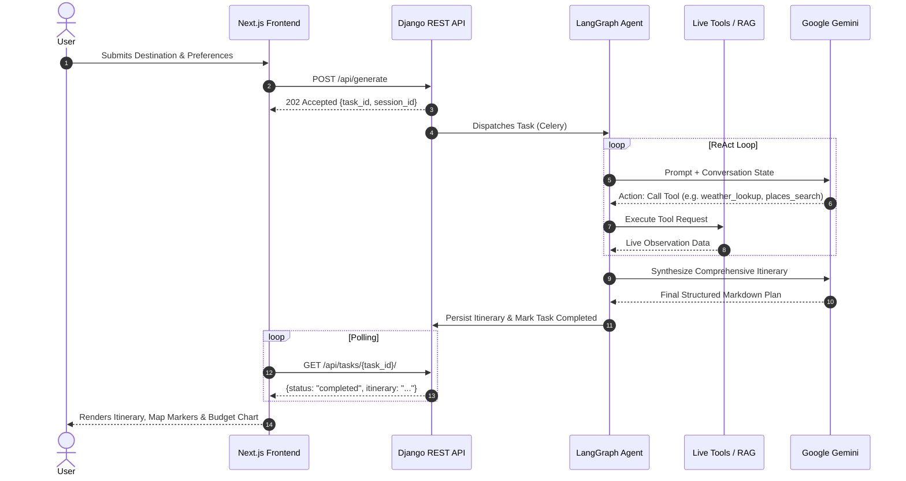

<p align="center">
  
</p>

<h1 align="center">✈️ TriPi — Agentic AI Travel Planner</h1>

<p align="center">
  <strong>An autonomous, tool-calling AI agent that crafts hyper-personalized, live-data-backed travel itineraries with interactive maps, budget tracking, and voice interaction.</strong><br/>
  Built with <b>LangGraph</b> · <b>Google Gemini</b> · <b>Django REST Framework</b> · <b>Celery</b> · <b>PostgreSQL / SQLite</b> · <b>Next.js 16</b>
</p>

<p align="center">
  
  
  
  
  
  
  
  
</p>

---

## 📌 Table of Contents

- [🧠 What is TriPi?](#-what-is-tripi)
- [✨ Key Features](#-key-features)
- [🏗️ System Architecture](#️-system-architecture)
- [🚀 Quick Start & How to Run](#-quick-start--how-to-run)
  - [Prerequisites](#prerequisites)
  - [Option A: Local Development (Recommended)](#option-a-local-development-recommended)
  - [Option B: Containerized with Docker Compose](#option-b-containerized-with-docker-compose)
- [📁 Project Structure](#-project-structure)
- [🤖 How the Agent Works (ReAct Loop)](#-how-the-agent-works-react-loop)
- [🎙️ Voice Interaction (STT & TTS)](#️-voice-interaction-stt--tts)
- [🔧 REST API Reference](#-rest-api-reference)
- [⚙️ Environment Variables](#️-environment-variables)
- [🧪 Testing & Quality Assurance](#-testing--quality-assurance)
- [❓ Troubleshooting & FAQ](#-troubleshooting--faq)
- [📄 License](#-license)

---

## 🧠 What is TriPi?

TriPi is not a standard static chatbot. It is a **fully autonomous agentic AI system** that functions as an intelligent personal travel concierge. When provided with a destination, travel dates, budget, travel style, and dietary or mobility requirements, the agent:

1. **Autonomously Reasons & Chains Tools**: Selects relevant live data providers (weather, attractions, currency, local facts, search, knowledge base) dynamically using the ReAct (Reason + Act) pattern.
2. **Retrieves Real-Time Ground Truth**: Queries external APIs and a built-in ChromaDB RAG vector store for verified travel tips, current safety guidelines, and live currency rates.
3. **Synthesizes Complete Itineraries**: Generates comprehensive day-by-day itineraries featuring exact timings, transport recommendations, meal spots matching dietary needs, estimated budgets, and bad-weather indoor alternatives.
4. **Refines Iteratively with Conversational Memory**: Supports multi-turn chat powered by LangGraph's `MemorySaver` — ask questions, swap activities, adjust budgets, or tailor plans dynamically.
5. **Interactive & Voice-Enabled**: Visualizes places on interactive Leaflet maps, breaks down budgets with dynamic donut charts, fetches real Unsplash destination photos, exports branded PDFs, and allows hands-free voice conversations with Speech-to-Text and Text-to-Speech.

---

## ✨ Key Features

| Feature | Category | Description |
|---|---|---|
| 🤖 **Autonomous ReAct Agent** | AI / Agentic | Powered by LangGraph and Google Gemini with dynamic tool selection and conversational state management. |
| 🎙️ **Voice AI (STT & TTS)** | Multimodal | Hands-free voice input (speech recognition) and natural speech output (voice player) supporting 8+ languages/accents. |
| 🌤️ **Live Weather Forecasts** | Real-Time Tool | Exact weather forecasts for travel dates via Open-Meteo to recommend outdoor vs. indoor activities. |
| 📍 **Smart Places Discovery** | Real-Time Tool | Discovers top attractions, monuments, restaurants, and hidden gems via OpenStreetMap & Overpass API. |
| 💰 **Live Currency Conversion** | Real-Time Tool | Real-time exchange rates via ExchangeRate-API with automatic conversions into destination currency. |
| 🌍 **Country & Travel Intel** | Real-Time Tool | Vital destination facts, languages, timezones, and emergency info via REST Countries API. |
| 📚 **RAG Knowledge Base** | Knowledge Retrieval | Curated guides (safety, packing lists, money-saving tips) embedded in ChromaDB with `models/gemini-embedding-001`. |
| 🔍 **Web Search Fallback** | Real-Time Tool | Live search via DuckDuckGo for festivals, temporary closures, and current travel advisories. |
| ✈️ **Flights & Hotels (Optional)**| External APIs | Integrated SerpApi (Google Flights) and Amadeus API for real flight pricing and hotel accommodations. |
| 🗺️ **Interactive Leaflet Map** | UI / Visualization | Day-by-day color-coded route markers, coordinates extraction, and custom popup details. |
| 💸 **Budget Tracker** | UI / Analytics | Visual SVG donut chart and spending category breakdown (Stay, Food, Activities, Transport). |
| 📸 **Destination Photo Gallery** | Media | Unsplash image integration with high-resolution lightbox previews. |
| 📄 **One-Click PDF Export** | Utility | Clean client-side export to formatted, printable A4 PDF itineraries with cover styling. |
| 🎨 **Hyper-Spectral Design** | UI / UX | Glassmorphism interface, light/dark themes, responsive layouts, and fluid Framer Motion animations. |

---

## 🏗️ System Architecture

```
┌────────────────────────────────────────────────────────────────────────────┐
│                            FRONTEND (Next.js 16)                           │
│  Landing Page  ·  Preferences Form  ·  Itinerary View  ·  Voice & Chat UI  │
│      React Leaflet Map  ·  Budget Donut  ·  PDF Export  ·  Framer Motion   │
│            Web Speech API (STT & TTS Voice Engine)                         │
└─────────────────────────────────────┬──────────────────────────────────────┘
                                      │  REST API (JSON over HTTP)
                                      ▼
┌────────────────────────────────────────────────────────────────────────────┐
│                      BACKEND (Django REST Framework)                       │
│                                                                            │
│  POST /api/generate   ─── Dispatches async agent task (Returns 202)        │
│  POST /api/refine     ─── Refines itinerary using session thread           │
│  POST /api/chat       ─── Conversational agent chat with thread memory     │
│  GET  /api/tasks/{id} ─── Task status polling endpoint                     │
│  GET  /api/voice-config ─ Supported languages & speech configuration       │
│  POST /api/extract-places ─ Extracts coordinates & POIs for Leaflet map    │
│  GET  /api/unsplash   ─── Destination photo proxy                          │
│  GET  /health         ─── Healthcheck probe                                │
│                                                                            │
│  • Storage: SQLite (Zero-setup Dev) or PostgreSQL (Production)             │
│  • Task Execution: Celery Eager (In-memory Dev) or Redis Worker (Prod)     │
└─────────────────────────────────────┬──────────────────────────────────────┘
                                      │
                         ┌────────────┴────────────┐
                         ▼                         ▼
┌──────────────────────────────────┐     ┌──────────────────────────────────┐
│      CELERY WORKER (Optional)    │     │      LANGGRAPH ReAct AGENT       │
│   (For background scaling with   │     │  (Google Gemini 3.8 / 2.5 Flash) │
│    Redis message broker)         │     │                                  │
│                                  │     │  State Loop:                     │
│  - Executes 30-60s agent jobs    │◄────┤  Reason ──► Act ──► Observe      │
│  - Updates DB task & session     │     │                                  │
│  - Handles retry & timeouts      │     │  Memory: MemorySaver (threads)   │
└──────────────────────────────────┘     └─────────────────┬────────────────┘
                                                           │
                      ┌────────────────────────────────────┴────────────────────────────────────┐
                      ▼                                                                         ▼
┌───────────────────────────────────────────────┐                     ┌───────────────────────────────────────────────┐
│               LIVE TOOL LAYER                 │                     │             KNOWLEDGE LAYER (RAG)             │
│  • Open-Meteo (Weather forecasts)             │                     │  • ChromaDB Vector Store                      │
│  • REST Countries (Destination facts)         │                     │  • Google Gemini Embeddings                   │
│  • Overpass / OpenStreetMap (Places & POIs)   │                     │  • Curated Markdown Guides:                   │
│  • ExchangeRate-API (Currency conversions)    │                     │    - Safety & Scam Advisories                 │
│  • DuckDuckGo (Live web search fallback)      │                     │    - Packing Checklists & Tips                │
│  • SerpApi / Amadeus (Flights & Hotels)       │                     │    - Budget Travel Hacks                      │
└───────────────────────────────────────────────┘                     └───────────────────────────────────────────────┘
```

### Why Django REST Framework + Celery?
- **Separation of Concerns**: Generating a comprehensive 5-day trip with 8+ external API calls takes 20-40 seconds. A synchronous web server would block worker threads. Django returns an immediate `202 Accepted` with a `task_id`, allowing the client to poll without timing out.
- **Graceful Local Fallback**: In development, Celery runs in eager (in-memory) mode and Django uses SQLite, meaning **no Docker, PostgreSQL, or Redis installation is required to run the project locally**.
- **Admin Dashboard**: Inspect sessions, itineraries, prompt history, and task statuses directly via Django's built-in `/admin/`.

---

## 🚀 Quick Start & How to Run

### Prerequisites

Ensure the following are installed on your machine:
- **Python 3.10+** — [Download Python](https://www.python.org/downloads/)
- **Node.js 18+ & npm** — [Download Node.js](https://nodejs.org/)
- **Google Gemini API Key** (Free) — [Get a Gemini API Key](https://aistudio.google.com/apikey)

---

### Option A: Local Development (Recommended)

Run TriPi natively on your computer in minutes with **zero database configuration** (uses SQLite + In-Memory Celery).

#### 1. Clone & Enter the Directory
```bash
git clone https://github.com/Shubhammm24/TriPi.git
cd TriPi
```

#### 2. Configure Environment Variables
Create a `.env` file in the project root:
```bash
# Windows (PowerShell)
Copy-Item .env.example .env

# macOS / Linux
cp .env.example .env
```

Open `.env` and add your Google Gemini API key:
```env
GOOGLE_API_KEY=your_gemini_api_key_here
```
*(Optional keys like `SERPAPI_API_KEY`, `AMADEUS_API_KEY`, and `UNSPLASH_ACCESS_KEY` can be left blank initially — TriPi operates with full functionality using only `GOOGLE_API_KEY`.)*

#### 3. Backend Setup

**Create and activate a virtual environment:**
```bash
# Windows
python -m venv venv
venv\Scripts\activate

# macOS / Linux
python3 -m venv venv
source venv/bin/activate
```

**Install dependencies:**
```bash
pip install -r requirements.txt
```

**Run database migrations:**
```bash
python backend/manage.py migrate
```

**(Optional) Ingest RAG Knowledge Base:**
Embed the curated travel safety, packing, and budget guides into ChromaDB:
```bash
python -m rag.ingest
```

**Start the Django Backend Server:**
```bash
python backend/manage.py runserver 8000
```
> 🟢 **Backend running at:** [http://127.0.0.1:8000](http://127.0.0.1:8000)  
> 🔍 **Health check:** [http://127.0.0.1:8000/health](http://127.0.0.1:8000/health)  
> 🛡️ **Django Admin:** [http://127.0.0.1:8000/admin](http://127.0.0.1:8000/admin)  

---

#### 4. Frontend Setup

Open a **separate terminal window**:

```bash
cd frontend

# Install Node modules
npm install

# Start Next.js development server
npm run dev
```

> 🟢 **Frontend running at:** [http://localhost:3000](http://localhost:3000)

---

#### 5. Open the Application
1. Open your browser and navigate to **`http://localhost:3000`**.
2. Click **"Start Planning"** to enter your trip destination, dates, budget, and travel preferences.
3. Click **"Generate Itinerary"** — the agent will execute real-time tools and generate your schedule.
4. Interact with the **interactive map**, **budget tracker**, **photo preview**, or use the **voice / chat panel** to refine!

---

### Option B: Containerized with Docker Compose

To run the complete production-grade stack including **PostgreSQL**, **Redis**, **Celery Worker**, **Django Backend**, and **Next.js Frontend**:

```bash
# Ensure Docker Desktop is installed and running
docker compose up --build -d
```

- Frontend: `http://localhost:3000`
- Backend API: `http://localhost:8000`
- Check logs: `docker compose logs -f`
- Stop containers: `docker compose down`

---

## 📁 Project Structure

```
TriPi/
├── agent/                          # LangGraph ReAct Autonomous Agent
│   ├── graph.py                    #   Agent builder: wires Gemini LLM + tools + MemorySaver
│   ├── prompts.py                  #   System prompts & synthesis templates
│   ├── state.py                    #   Pydantic state schemas (AgentState, TripRequest)
│   └── callbacks.py                #   Real-time activity callbacks for UI tracking
│
├── backend/                        # Django REST Framework Backend
│   ├── manage.py                   #   Django management script
│   ├── tripi_project/              #   Root configuration
│   │   ├── settings.py             #     Database & Celery auto-fallback configuration
│   │   ├── urls.py                 #     Root routing (/api/, /admin/, /health)
│   │   ├── wsgi.py                 #     WSGI entry point for Gunicorn
│   │   └── celery.py               #     Celery broker & task app initialization
│   ├── trips/                      #   Trip planning application
│   │   ├── models.py               #     Session, TripPreferences, Itinerary, Message, AgentTask
│   │   ├── views.py                #     Generate, Refine, Chat, Tasks, VoiceConfig, Places
│   │   ├── serializers.py          #     DRF request/response validation schemas
│   │   ├── tasks.py                #     Celery async task running LangGraph agent
│   │   ├── admin.py                #     Django admin inspection dashboards
│   │   └── urls.py                 #     Trip endpoint routes
│   └── accounts/                   #   User authentication application
│       ├── models.py               #     CustomUser model
│       └── urls.py                 #     JWT login, register, token refresh
│
├── frontend/                       # Next.js 16 Web Application (App Router)
│   ├── package.json                #   Frontend dependencies & scripts
│   ├── src/
│   │   ├── app/
│   │   │   ├── page.tsx            #   Landing hero page with feature highlights
│   │   │   ├── plan/page.tsx       #   Main planning console (Form ➔ Itinerary ➔ Chat)
│   │   │   ├── layout.tsx          #   Root HTML layout & theme wrapper
│   │   │   ├── globals.css         #   Glassmorphism CSS design system & tokens
│   │   │   ├── components/         #   UI Components:
│   │   │   │   ├── Navbar.tsx      #     Navigation bar with dark/light mode toggle
│   │   │   │   ├── ItineraryMap.tsx#     Leaflet.js map with color-coded day markers
│   │   │   │   ├── BudgetTracker.tsx#    SVG category donut chart & cost analytics
│   │   │   │   ├── PhotoPreview.tsx#     Unsplash destination gallery & lightbox
│   │   │   │   ├── PdfExport.tsx   #     Client-side formatted A4 PDF exporter
│   │   │   │   ├── VoiceChatPanel.tsx#   Conversational voice interface panel
│   │   │   │   ├── VoiceInput.tsx  #     Microphone recording button & speech recognition
│   │   │   │   ├── VoicePlayer.tsx #     TTS audio playback with play/pause/rate controls
│   │   │   │   └── VoiceSettings.tsx#    Voice selection, pitch, rate, language dialog
│   │   │   └── hooks/              #   Custom React Hooks:
│   │   │       ├── useVoice.ts     #     SpeechRecognition lifecycle & transcription
│   │   │       ├── useTTS.ts       #     SpeechSynthesis speech audio synthesizer
│   │   │       └── useVoiceSettings.ts#  User voice preferences persistence
│   │   └── types/
│   │       └── speech.d.ts         #   TypeScript declarations for Web Speech API
│
├── rag/                            # Retrieval-Augmented Generation Layer
│   ├── data/                       #   Curated Markdown guides
│   │   ├── safety_tips.md          #     Emergency guidelines, scams, local advice
│   │   ├── packing_guides.md       #     Checklists by climate and duration
│   │   └── budget_tips.md          #     Money-saving, transport hacks, dining tips
│   ├── ingest.py                   #   Document loader, splitter, and vector embedder
│   └── store.py                    #   Persistent ChromaDB vector store interface
│
├── tools/                          # Agent Tools (LangChain @tool definitions)
│   ├── weather.py                  #   Open-Meteo live weather forecasts
│   ├── places.py                   #   Overpass / OpenStreetMap attraction discovery
│   ├── destination.py              #   REST Countries country intelligence
│   ├── currency.py                 #   ExchangeRate-API live conversions
│   ├── knowledge.py                #   ChromaDB RAG semantic search
│   ├── web_search.py               #   DuckDuckGo search fallback
│   ├── flights.py                  #   (Optional) SerpApi / Google Flights
│   └── hotels.py                   #   (Optional) Amadeus hotel accommodation
│
├── utils/                          # Supporting utilities & legacy reference
├── Dockerfile.backend              # Production container for Django & Celery
├── Dockerfile.frontend             # Production container for Next.js
├── docker-compose.yml              # Multi-container orchestration (DB, Redis, Worker, Web)
├── requirements.txt                # Python backend dependencies
└── README.md                       # Complete project documentation
```

---

## 🤖 How the Agent Works (ReAct Loop)



### The ReAct Pattern
- **Reason**: The agent evaluates what information is still missing to build an ideal schedule (e.g., "I need the forecast for Kyoto between Oct 10-15 and top vegetarian ramen spots").
- **Act**: Executes relevant LangChain tools (`weather_lookup`, `places_search`, `currency_convert`).
- **Observe**: Analyzes tool outputs (e.g., "Rain is forecast on Day 2; I will schedule indoor museums instead of bamboo grove hikes").
- **Synthesize**: Combines all live facts into a structured, chronologically sequenced trip plan.

---

## 🎙️ Voice Interaction (STT & TTS)

TriPi features built-in voice assistance powered by the **Web Speech API**:

1. **Speech-to-Text (Voice Input)**:
   - Click the microphone button in the chat panel to speak your questions or refinement prompts (e.g., *"Can you swap day 3 dinner with an outdoor food market?"*).
   - Real-time speech recognition displays live transcription before sending.
2. **Text-to-Speech (Voice Playback)**:
   - Listen to the agent read out the full itinerary or chat responses aloud.
   - Includes controls for play, pause, resume, stop, and playback speed adjustments.
3. **Multilingual & Accent Support**:
   - Customizable voice settings for **English (US, UK, India)**, **Spanish**, **French**, **German**, **Japanese**, and **Hindi**.

---

## 🔧 REST API Reference

### 1. `POST /api/generate`
Dispatches an asynchronous trip generation task.

**Request:**
```json
{
  "destination": "Tokyo",
  "origin": "San Francisco",
  "duration": 5,
  "start_date": "2026-11-01",
  "end_date": "2026-11-06",
  "budget": "$3500",
  "purpose": "Leisure & Culture",
  "interests": ["Food & Dining", "Historic Temples", "Anime & Tech"],
  "dietary_preferences": ["Vegetarian"],
  "accommodation_type": "Boutique Hotel",
  "walking_tolerance": "High",
  "hidden_gems_preference": true
}
```
**Response (202 Accepted):**
```json
{
  "session_id": "7b36f014-9964-4e78-98e8-6e542d8cae29",
  "task_id": "d8e3ab42-4f81-432b-8a19-9436ea3a58e3",
  "status": "pending"
}
```

---

### 2. `GET /api/tasks/{task_id}/`
Polls the execution status of an agent run.

**Response (In Progress):**
```json
{
  "task_id": "d8e3ab42-4f81-432b-8a19-9436ea3a58e3",
  "status": "running"
}
```

**Response (Completed):**
```json
{
  "task_id": "d8e3ab42-4f81-432b-8a19-9436ea3a58e3",
  "status": "completed",
  "result": {
    "itinerary": "# 5-Day Tokyo Adventure\n\n## Day 1: Arrival & Shibuya...",
    "tool_calls": ["weather_lookup", "destination_info", "places_search", "currency_convert"]
  }
}
```

---

### 3. `POST /api/chat`
Conversational follow-up and refinement using LangGraph thread memory.

**Request:**
```json
{
  "session_id": "7b36f014-9964-4e78-98e8-6e542d8cae29",
  "message": "Which subway pass should I buy at Haneda airport for this trip?"
}
```

---

### 4. `POST /api/extract-places`
Extracts structured locations (names, categories, latitude/longitude coordinates) from markdown itineraries to render Leaflet map pins.

---

### 5. `GET /api/voice-config`
Returns available speech-to-text and text-to-speech configurations, language codes, and active voice engines.

---

### 6. `GET /health`
Liveness check probe.
```json
{
  "status": "ok",
  "agent": "TriPi v2.0 (Django)"
}
```

---

## ⚙️ Environment Variables

Configure these keys in your `.env` file at the root of the project:

| Variable | Required | Default | Description |
|---|---|---|---|
| `GOOGLE_API_KEY` | **Yes** | — | Google Gemini API key used by the LLM & RAG embeddings. |
| `GEMINI_MODEL` | No | `gemini-3.8-flash` | Gemini model name (e.g. `gemini-3.8-flash`, `gemini-2.5-flash`). |
| `DJANGO_SECRET_KEY` | No | Auto-generated dev key | Django cryptography secret key. |
| `DJANGO_DEBUG` | No | `True` | Enables Django debug mode for local development. |
| `USE_POSTGRES` | No | `False` | When `True`, connects to Postgres; otherwise uses SQLite. |
| `POSTGRES_DB` | No | `tripi` | PostgreSQL database name. |
| `POSTGRES_USER` | No | `tripi` | PostgreSQL username. |
| `POSTGRES_PASSWORD` | No | `tripi_dev` | PostgreSQL user password. |
| `POSTGRES_HOST` | No | `localhost` | PostgreSQL host. |
| `USE_REDIS` | No | `False` | When `True`, connects to Redis; otherwise runs Celery in eager memory. |
| `REDIS_URL` | No | `redis://localhost:6379/0` | Redis broker and results connection string. |
| `SERPAPI_API_KEY` | No | — | Optional: unlocks real Google Flights search schedules & fares. |
| `AMADEUS_API_KEY` | No | — | Optional: unlocks live hotel accommodation discovery. |
| `AMADEUS_API_SECRET` | No | — | Optional: Amadeus API authentication secret. |
| `UNSPLASH_ACCESS_KEY`| No | — | Optional: fetches destination photo galleries from Unsplash. |
| `NEXT_PUBLIC_API_URL`| No | `http://localhost:8000` | Backend API base URL consumed by Next.js frontend. |

---

## 🧪 Testing & Quality Assurance

Run backend automated tests using pytest:

```bash
# Activate your virtual environment first
venv\Scripts\activate      # Windows
source venv/bin/activate   # macOS / Linux

# Run test suite
pytest

# Run Django unit tests directly
python backend/manage.py test backend/trips
```

---

## ❓ Troubleshooting & FAQ

<details>
<summary><b>1. "No module named django" or "No module named uvicorn"</b></summary>
Ensure your virtual environment is activated and dependencies are installed:
```bash
venv\Scripts\activate          # Windows
pip install -r requirements.txt
```
*Note: TriPi now uses Django (`python backend/manage.py runserver 8000`), so `uvicorn` is no longer used.*
</details>

<details>
<summary><b>2. "404 NOT_FOUND models/embedding-001" during RAG ingestion</b></summary>
The legacy Gemini embedding model `embedding-001` has been updated in `rag/store.py` to `models/gemini-embedding-001`. Run:
```bash
python -m rag.ingest
```
</details>

<details>
<summary><b>3. Do I need PostgreSQL or Redis to run the project locally?</b></summary>
**No.** TriPi includes automatic dev fallbacks. When `USE_POSTGRES` and `USE_REDIS` are not set to `true`, TriPi runs seamlessly with local **SQLite** and **in-memory Celery**, making local testing fast and zero-friction.
</details>

<details>
<summary><b>4. Port 8000 or Port 3000 is already in use</b></summary>
You can specify alternate ports:
```bash
# Backend on port 8001
python backend/manage.py runserver 8001

# Frontend on port 3001
cd frontend && npm run dev -- -p 3001
```
*(If you change the backend port, remember to set `NEXT_PUBLIC_API_URL=http://localhost:8001` in your frontend environment).*
</details>

---

## 📄 License

This project is licensed under the **MIT License** — see the [LICENSE](LICENSE) file for details.

<p align="center">
  Built with ❤️ by <a href="https://github.com/Shubhammm24">Shubham</a><br/>
  <sub>Powered by LangGraph · Google Gemini · Django REST Framework · Next.js</sub>
</p>
